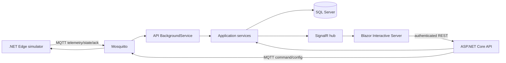

# Architecture

Domain has no project dependencies. Application depends on Domain. Infrastructure implements Application abstractions and owns EF Core persistence. API currently hosts MQTT ingestion, composes services and exposes REST/SignalR. Identity and device-control transport are planned work. Web owns presentation and calls API. Simulator imports Contracts only and never queries SQL Server.

The first vertical slice is a single sensor measurement from Simulator to MQTT to API to SQL Server to SignalR to Web. Start with one farm, one barn, one batch and one edge device but keep all IDs scoped for multiple sites. Authentication, command execution and Edge safety follow only after telemetry provenance and freshness are established.

Security boundary: Internet clients reach Web/API over HTTPS. For local development, SQL Server LocalDB and Mosquitto run on the Windows host; the broker binds only to loopback port 1884. Production deployments must restrict database and broker network access. Production MQTT requires per-device identity, TLS and topic ACL; the local demo broker configuration is for development only. No secrets belong in source control.

Reliability boundary: the Edge controls the physical outputs when disconnected. Backend stores intents and observations, checks timeouts and raises alerts. No browser state is treated as device truth.
