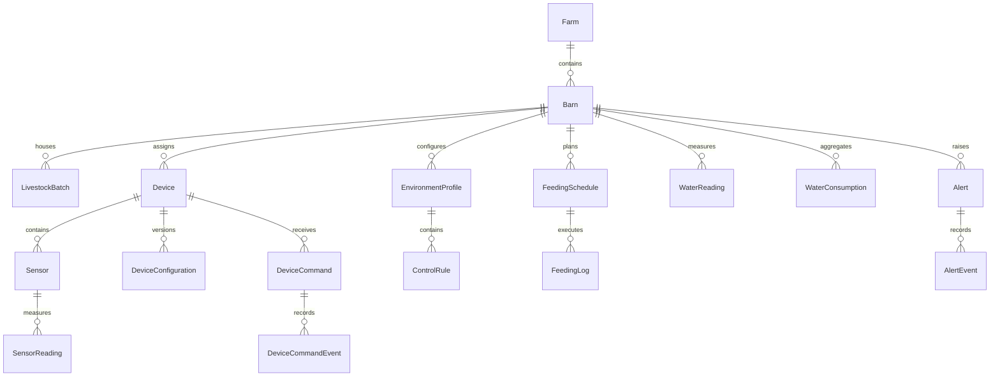

# Database design

SQL Server, EF Core Code First. GUID primary keys mapped to uniqueidentifier; UTC timestamps mapped to datetimeoffset; decimal for mass, volume and concentrations. Created/updated audit fields are required as later entities are implemented; the initial telemetry schema is a partial slice. Delete farms/barns with dependent history only through an explicit archival workflow; ordinary UI delete is soft delete or rejected.

Key fields and constraints:
- Farm: id, name, code unique.
- Barn: id, farm_id FK, code unique per farm, capacity, status.
- LivestockBatch: id, barn_id FK, species, started_at, initial_count, current_count; current_count >= 0 and <= capacity is validated in the service.
- Device: id, barn_id FK, external_device_id unique, type, firmware_version, last_seen_at, status.
- Sensor: id, device_id FK, metric, unit, calibration_version, status; unique(device_id, metric, sensor channel).
- SensorReading: id, sensor_id FK, message_id unique per device, sequence, measured_at, received_at, value decimal, quality; index(sensor_id, measured_at DESC). Never use invalid/stale readings for automation.
- EnvironmentProfile: id, barn_id FK, species, age_min_days, age_max_days, version, active; exactly one active applicable version per barn enforced by transactional service and partial index where possible.
- ControlRule: id, profile_id FK, metric, lower/upper limits, hysteresis, minimum_switch_interval, action. Limits are null until reviewed.
- DeviceConfiguration: id, device_id FK, version unique per device, payload, published_at, applied_at.
- DeviceCommand: id, device_id FK, command_id unique, requested_by, issued_at, expires_at, state, desired_payload. State advances through queued, published, acknowledged, applied, failed or timed_out.
- DeviceCommandEvent: id, command_id FK, event_type, occurred_at, payload; append only.
- FeedingSchedule: id, barn_id FK, local_time, timezone, target_kg, enabled, version.
- FeedingLog: id, schedule_id FK, occurrence_key unique, command_id unique, target_kg, actual_kg, state, started_at, finished_at. Unique occurrence_key guards restart duplication.
- WaterReading: id, barn_id FK, device_id FK, measured_at, received_at, cumulative_liters, quality, message_id unique per device. Detect counter reset or rollover.
- WaterConsumption: id, barn_id FK, period_start, period_end, liters, data_quality; unique(barn_id, period_start, period_end).
- Alert: id, barn_id FK, type, severity, dedupe_key, state, first_seen_at, last_seen_at, acknowledged_by, resolved_by. Partial unique index on open dedupe_key.
- AlertEvent: id, alert_id FK, action, actor_id, occurred_at, note; append only.
- Identity tables: ASP.NET Core Identity users, roles and memberships; user IDs are used for command and alert audit.

Retention proposal: raw telemetry 90 days in the demo, daily aggregates retained longer; delete only after backup verification. Partition raw readings by month when scale warrants it. Backup: scheduled SQL Server BACKUP DATABASE plus periodic restore drill. These intervals remain configurable.
